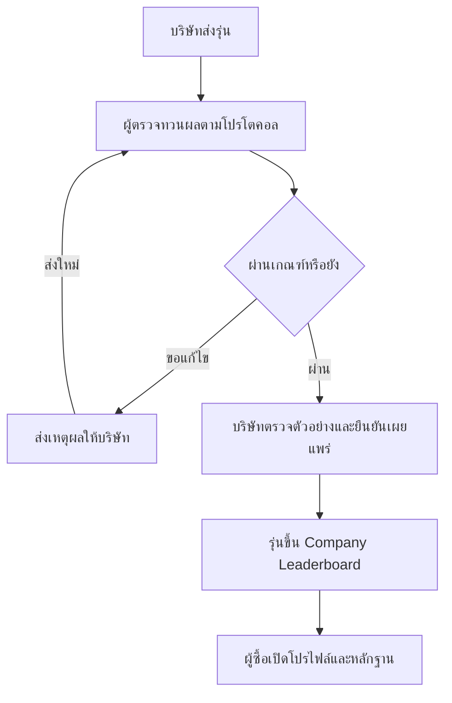

# Thai Robotics Platform · Demo-First Module Roadmap

**งานแรกสำหรับส่งประกวดคือ M01 · HumanoidTH HRI Living Lab**

## ผลตรวจและการพัฒนาล่าสุด · 8 พฤศจิกายน 2026

มีซอฟต์แวร์นำร่องของ M01–M11 แล้วในแอป Next.js เดิม โดยพัฒนาตามคำขอให้ทำฟีเจอร์ที่ยังขาด การปิดโมดูลยังต้องใช้หลักฐานจริงตามเกณฑ์ด้านล่าง รายละเอียดการเปิดเว็บ บทบาท เส้นทางเดโม และข้อจำกัดอยู่ใน [Working platform pilot](docs/platform-pilot.md)

| โมดูล | สถานะซอฟต์แวร์นำร่อง |
| --- | --- |
| M01 | ใช้รุ่นที่นำเข้าจาก Atlas จริง ทดสอบ HRI 4 ทาง บันทึก/โหลดซ้ำจากฐานข้อมูล และส่งออก log ได้; ยังรอหลักฐานจากผู้ทดลองจริงและ commit ส่งประกวด |
| M02 | แยกข้อมูลสาธารณะ/ส่วนตัวที่เซิร์ฟเวอร์ ตรวจสมาชิกบริษัท มอบหมายผู้ตรวจ ตรวจเวอร์ชันที่รับรอง ยืนยันเผยแพร่ และสร้างเวอร์ชันใหม่โดยไม่แก้ผลเดิม |
| M03 | มีคำขอประเมิน ขอข้อมูลเพิ่ม แผนค่าใช้จ่าย/นัด ยืนยัน รับหุ่น ผล 5 รอบ รับรองรายงานนำร่อง และบันทึกคืนหุ่น; โปรโตคอลที่เปิดตอนนี้ติดป้ายข้อมูลเดโม |
| M04 | พอร์ทัลหลายรุ่น/เวอร์ชัน เอกสาร URL ส่วนตัว ประวัติการทบทวน และเชื่อมรายงานที่ตรงฮาร์ดแวร์/เฟิร์มแวร์ก่อนเผยแพร่ |
| M05 | Benchmark แยก Physical กับ Simulation ตามโปรโตคอล/ฉากเดียวกัน พร้อมหน่วย ลำดับจัดอันดับ ตัวเลือกเผยแพร่และถอนความยินยอม |
| M06 | Workspace บันทึกคำสั่ง F/L/R รันฝึก/ส่งประเมินผ่านคิว ดูผล ล้มเหลว ยกเลิก Replay และประวัติได้ เป็น grid simulator แบบจำกัดคำสั่ง |
| M07 | รายการแข่งจากฐานข้อมูล สมัครทีม ตรวจ/ขอแก้คุณสมบัติ เช็กอิน บันทึกคะแนน ทักท้วง รับรองผล และอันดับทางการพร้อมประวัติแก้คะแนน |
| M08 | รองรับ Online/On-site/Hybrid ผูกรอบจำลองกับใบสมัคร ใช้คะแนนจาก worker คัดเลือกเข้า On-site และแยกช่วงทักท้วง/อันดับตามรอบ |
| M09 | มีบทเรียนไทย 3 บท ฝึกจาก Atlas/Simulator บันทึกความคืบหน้าในบัญชีและเรียนต่อจากพื้นที่ของฉัน |
| M10 | ร่างโพสต์ในบัญชี แหล่งอ้างอิงข่าว/วิจัย รายงานเนื้อหา คิวผู้ดูแล ซ่อน/คืนเนื้อหา และแจ้งสถานะกับผู้เขียน |
| M11 | มี /me รวมรายการส่วนตัว/งานที่ได้รับมอบหมาย การค้นหาข้อมูลที่เผยแพร่ ตัวกรองประเภท ลิงก์จากหน้าแรก/เมนู และเข้าสู่ระบบแล้วกลับงานที่เลือก |

**ฐานข้อมูล:** เตรียมฐานข้อมูลนำร่องในเครื่องที่ 127.0.0.1:5433 แล้ว มี Atlas robot models 17 รุ่น แอปใช้ .env.local ซึ่งไม่ถูก commit และเก็บ .env เดิมไว้ เปิดเว็บเต็มได้ด้วยคำสั่ง pnpm demo แล้วไป http://127.0.0.1:3000 เลือกบทบาทที่ /demo

**การตรวจรับซอฟต์แวร์:** มี unit tests, integration tests ที่ใช้ฐานข้อมูลจริงในเครื่อง, browser tests ที่ใช้ session จริง และการทดสอบ migration ตั้งแต่ฐานข้อมูลว่าง รายละเอียดผลและคำสั่งอยู่ในเอกสารนำร่อง รายการ /challenges เดิมยังเป็นแค็ตตาล็อกตัวอย่าง ส่วน workflow แข่งขันที่บันทึกจริงอยู่ที่ /competitions

**ยังไม่ถือว่าปิดทุกโมดูล:** การทดสอบหุ่นจริง โปรโตคอล/ห้องทดสอบที่ตกลงกับพันธมิตร ข้อสังเกตจากคนจริง ผู้รับผิดชอบสถานที่นำร่อง การซ้อมบนเครื่องพรีเซนต์ และ commit ส่งประกวด ยังต้องเก็บหลักฐาน ไม่อ้างว่าข้อมูลเดโมเป็นผลรับรองหุ่นจริง

## เป้าหมายโครงการ

**Thai Robotics Platform** คือแพลตฟอร์มภาษาไทยที่ใช้การแข่งขันและการประเมินหุ่นยนต์เพื่อพัฒนาวงการหุ่นยนต์ไทย คนทั่วประเทศเริ่มเรียนและฝึกได้แม้ยังไม่มีหุ่นยนต์ ทีมแข่งขันนำผลไปพัฒนาผลงาน ส่วนผู้ซื้อใช้หลักฐานการทดสอบประกอบการเปรียบเทียบหุ่นยนต์แต่ละรุ่นได้

## ฟีเจอร์ที่กำหนดไว้ในแผนปัจจุบัน

| ฟีเจอร์ | ผู้ใช้ทำอะไรได้ |
| --- | --- |
| **ชุมชน** | ติดตามข่าว เทรนด์ และงานวิจัยพร้อมแหล่งอ้างอิง ตั้งกระทู้ถามตอบ และแชร์ผลงาน |
| **บทเรียนและ Online Simulator** | เรียนจากคู่มือภาษาไทย ใช้โมเดลและฉากที่เตรียมไว้ฝึก ส่งโปรแกรมประเมิน และดูผลเพื่อปรับปรุง |
| **การแข่งขัน** | สมัครและลงแข่งแบบ Online, On-site หรือ Hybrid ผู้จัดกำหนดกติกาและเกณฑ์คัดเลือก กรรมการตรวจผลก่อนประกาศ |
| **บริการประเมินหุ่นยนต์จริง** | บุคคลและบริษัทส่งหุ่นมาทดสอบตามงานและตัวชี้วัด เช่น Safety, Speed และ Precision แล้วรับรายงานส่วนตัว |
| **Leaderboard สามประเภท** | **Competition** แสดงผลตามรายการและรอบ, **Benchmark** เปรียบเทียบผลภายใต้เงื่อนไขเดียวกันโดยแยก Simulation กับ Physical, และ **Company** แสดงรุ่นที่ผ่านเกณฑ์และได้รับอนุญาตให้เผยแพร่ |
| **Company Portal** | บริษัทยื่นหุ่นยนต์เป็นรายรุ่นและเวอร์ชัน ติดตามผล แก้ไขหรือทดสอบซ้ำ รุ่นที่ผ่านการประเมินจริงและยืนยันเผยแพร่จึงเสนอขายผ่านแพลตฟอร์มได้ |
| **Dashboard และหน้าทำงานตามบทบาท** | ผู้ใช้ติดตามบทเรียน ใบสมัคร รอบจำลอง และคำขอทดสอบ ส่วนผู้จัด กรรมการ และทีมตรวจมีคิวงานตามสิทธิ์ |

## สถานะและงานแรก

ตอนนี้มี **Flow โครงการ, Website Page Flow 22 แท็บ และ Roadmap 11 โมดูล** โดยจัดให้ M01 เป็นงานที่ต้องทำให้รันได้และมีหลักฐานสำหรับการตัดสิน

ใช้ M01 เปิดเดโมจากทะเบียนหุ่นยนต์ใน fork ของ HumanoidTH ให้กรรมการเลือกวิธีขอความช่วยเหลือและดูผลของรอบที่เพิ่งรัน งาน M02–M11 เป็นแผนต่อยอดหลังการส่งประกวด โดย M02 พัฒนา Company Leaderboard สำหรับฝั่งบริษัทและผู้ซื้อ

ประกาศกิจกรรมระบุให้ Fork HumanoidTH และเพิ่มฟีเจอร์ที่เชื่อมกับระบบเดิมในธีม HRI Wellness Living Lab [รายละเอียดกิจกรรมจากผู้จัดบน CAMPHUB](https://www.camphub.in.th/hri-hackathon-thailand-2026/)

## เกณฑ์ตัดสินและหลักฐานส่งประกวด

กรรมการให้คะแนนเต็ม **100 คะแนนต่อท่าน** กรรมการ 3 ท่านรวม **300 คะแนน** ตามเกณฑ์ที่ได้รับ งาน P0 คือ M01 โดยให้ปิดเงื่อนไขการต่อยอดและการรันจริงก่อนซ้อมนำเสนอ

| เกณฑ์ | คะแนนต่อท่าน | สิ่งที่ M01 ต้องแสดงให้เห็น | หลักฐานที่ต้องเตรียม |
| --- | ---: | --- | --- |
| Scientific & Technical Accuracy | 35 | ใช้โค้ดและข้อมูลจาก HumanoidTH จริง อธิบายการเปลี่ยนสถานะของ HRI การวัด และขอบเขตผลได้ ระบบรับมือกรณียกเลิกหรือเปิดข้อมูลไม่สำเร็จ | ลิงก์ fork และ commit ฐาน, diff ฟีเจอร์, ขั้นตอนรัน, ผลตรวจโค้ด, Run Log และตารางผลทดสอบเทียบกับที่คาดไว้ |
| Real-World Impact & Feasibility | 30 | แก้ปัญหาคนตัดสินใจยากเมื่อต้องขอความช่วยเหลือจากหุ่นที่จุดบริการ มีทางเลือกขอเจ้าหน้าที่และเห็นผลการกระทำ อธิบายผู้ใช้ ผู้จ่ายเงิน วิธีนำร่อง และการขยายงานในไทย | ข้อสังเกตจากผู้ทดลองหรือผู้ให้บริการจริง ขอบเขตงานนำร่อง ต้นทุนและทรัพยากรที่ต้องตรวจสอบ และสมมติฐานรายได้ |
| Creative Design & Human-Centered Innovation | 25 | เริ่มจากทะเบียนรุ่นเดิมแล้วทดลอง HRI ได้ เปรียบเทียบ UI เดิมกับ UI ที่เพิ่ม อธิบายเหตุผลของปุ่ม ภาษาไทย การใช้คีย์บอร์ด และสถานะที่สื่อด้วยข้อความ | ภาพก่อนและหลัง, แผ่นสรุป CI, Mood Board และ Design System, หลักฐานทดสอบการใช้งานและสิ่งที่แก้จากข้อสังเกต |
| Demonstration & Communication | 10 | รันจาก fork ต่อหน้ากรรมการ ให้ผู้ชมเลือกทางหนึ่ง แล้วเปิดผลของรอบนั้น อธิบายสิ่งที่เพิ่ม หลักฐาน และแผนใช้จริง | สคริปต์ 3 นาที ผลซ้อมบนเครื่องจริง Run Log และคำตอบสำหรับกรรมการ พร้อม Replay สำหรับเปิดประกอบ |
| **รวม** | **100** | | |

**เงื่อนไขก่อนปิด M01** ต้องรันงานที่พัฒนาต่อยอดจาก HumanoidTH พร้อมฟีเจอร์ใหม่อย่างน้อยหนึ่งฟีเจอร์ที่ตรวจได้จากโค้ดและทดลองได้ในแอป ให้ข้อสรุปอยู่ในขอบเขตของผลที่ทดสอบจริง หากกล่าวอ้างผลด้านสุขภาพหรือ Wellness ต้องมีหลักฐานที่เหมาะสมรองรับตามเกณฑ์

## วิธีทำงานทีละโมดูล

1. เลือกโมดูลแรกที่ยังไม่ผ่านเกณฑ์จบ แล้วระบุผู้รับผิดชอบกับหน้าจอปลายทางที่ต้องส่งมอบ
2. ทำเส้นทางปกติให้ใช้ได้ครบจากหน้าต้นทางถึงผลลัพธ์ ก่อนเก็บทางแก้ไข การลองซ้ำ และสิทธิ์ของแต่ละบทบาท
3. หากต้องใช้ความสามารถร่วม เช่น เข้าสู่ระบบ ให้ทำส่วนที่จำเป็นต่อเส้นทางของโมดูลนั้น แล้วนำไปใช้ต่อในโมดูลถัดไป
4. เดินเดโมจากข้อมูลเริ่มต้นตามรายการตรวจรับ บันทึกหลักฐานที่ผ่านและแก้รายการที่ยังติด
5. ปิดโมดูลเมื่อผ่านเกณฑ์จบทุกข้อ จากนั้นเปิดงานโมดูลถัดไปตามลำดับ

| ลำดับ | ความสำคัญ | โมดูล | สิ่งที่ต้องเสร็จก่อน |
| --- | --- | --- | --- |
| M01 | P0 · ส่งประกวด | HumanoidTH HRI Living Lab | Fork ฐานที่ผู้จัดกำหนดและเปิดทะเบียนรุ่นเดิมได้ |
| M02 | P1 · ต่อยอดหลังส่งประกวด | Company Leaderboard และการเผยแพร่ผลประเมินรายรุ่น | ปิดเกณฑ์ M01 และส่งงาน |
| M03 | P1 · นำร่องจริง | ส่งหุ่นจริงและระบบงานห้องทดสอบ | M02 |
| M04 | P1 · นำร่องจริง | Company Portal และวงจรอนุมัติตามเวอร์ชัน | M03 |
| M05 | P1 · นำร่องจริง | Benchmark Leaderboard และหน้าผลสาธารณะ | M03–M04 |
| M06 | P2 · ขยายวิธีเข้าร่วม | Online Simulator และผลการรัน | M01 และ M05 |
| M07 | P2 · ขยายวิธีเข้าร่วม | การแข่งขัน On-site ตั้งแต่สมัครถึงประกาศผล | M06 ตามลำดับงาน |
| M08 | P2 · ขยายวิธีเข้าร่วม | การแข่งขัน Online และ Hybrid | M06–M07 |
| M09 | P3 · ขยายการเรียนรู้ | บทเรียนภาษาไทยและโจทย์ฝึกสำหรับมือใหม่ | M08 ตามลำดับงาน |
| M10 | P3 · ขยายชุมชน | ฟีด ข่าว งานวิจัย กระทู้ และการดูแลเนื้อหา | M09 ตามลำดับงาน |
| M11 | P3 · เชื่อมประสบการณ์ | หน้าแรก การค้นหา และ Dashboard กลาง | M01–M10 |

## M01 · HumanoidTH HRI Living Lab

**ฟีเจอร์ใหม่ที่เสนอ** เพิ่มปุ่ม **ทดลอง HRI** บนรายการรุ่นในทะเบียนหุ่นยนต์ของ HumanoidTH แล้วเปิดสถานการณ์จำลองจุดต้อนรับศูนย์สุขภาวะ ผู้ชมเลือกรุ่นจากข้อมูลเดิม จากนั้นเลือก **ให้หุ่นช่วยนำทาง**, **ขอเจ้าหน้าที่** หรือ **ยกเลิก** ระบบเปลี่ยนสถานะตามที่เลือก และสร้างรายงานจากการกดและการตอบสนองในรอบนั้น

หน้าทะเบียน `/robots` เป็นจุดต่อยอดที่ระบุใน README สาธารณะ ให้ตรวจ path และรูปแบบรหัสรุ่นจาก commit ฐานที่ทีมใช้จริงก่อนลงมือ ระบุชื่อรุ่นและแหล่งที่มาจาก record ของ Atlas บนหน้าทดลอง ส่วนภารกิจและพฤติกรรมให้แสดงป้าย **สถานการณ์จำลอง HRI** พร้อมแยกแหล่งข้อมูลของทะเบียนออกจากผลของรอบจำลอง [HumanoidTH บน GitHub](https://github.com/taechasith/HumanoidTH)

### ทำตามลำดับ

1. [ ] **ยืนยันฐานที่ต่อยอด** Fork repository ตามที่ผู้จัดกำหนด บันทึก URL และ `BASE_COMMIT` ทำตาม README จนเปิดทะเบียนเดิมบนเครื่องเดโมได้ เลือกรุ่นหนึ่งรายการที่อ่านจากฐานข้อมูลของแอป และเก็บภาพก่อนปรับ
2. [x] **เชื่อมฟีเจอร์เข้าหน้าจริง** เพิ่มปุ่มทดลอง HRI ให้ใช้รหัสรุ่นที่ผู้ใช้เลือก เปิดหน้าทดลองผ่าน layout และภาษาเดิมของ HumanoidTH แสดงชื่อรุ่นกับแหล่งข้อมูลที่มีอยู่ ตรวจจากโค้ดและหน้าจอว่ามีจุดทำงานใหม่จากฐานเดิม
3. [x] **รันสถานการณ์และให้ผู้ใช้ควบคุม** แสดงตัวเลือกเป็นข้อความ เมื่อเลือกให้หุ่นช่วยจึงแสดงไอคอนหุ่นเคลื่อนตามเส้นทางในฉากจำลองพร้อมสถานะ เมื่อขอเจ้าหน้าที่ให้เปลี่ยนไปสถานะส่งต่อในฉากจำลอง ให้ยกเลิกและเริ่มรอบใหม่ได้ — ตรวจด้วย engine/API tests และ browser fixture แล้ว
4. [x] **สร้างหลักฐานจากเหตุการณ์ที่เกิดขึ้น** เก็บรหัสรอบ รหัสรุ่น เวอร์ชันฉาก โหมดจำลอง เหตุการณ์ตามลำดับ เวลา ผลลัพธ์ และเหตุผลเมื่อจบด้วยข้อผิดพลาด ให้เปิดผลและส่งออก Run Log ได้ ใช้ข้อมูลสมมติของผู้รับบริการในเดโม — ตรวจทั้ง controlled tests และการบันทึก/โหลดจากฐานข้อมูลนำร่องจริงในเครื่องแล้ว
5. [x] **ตรวจความถูกต้องและการใช้งาน** ทดสอบเส้นทางสำเร็จ ส่งต่อ ยกเลิก และกรณีโหลดรุ่นหรือรันไม่สำเร็จ บันทึกผลที่พบจริง รันชุดตรวจของ fork ที่ใช้ เช่น `pnpm test`, `pnpm typecheck` และ `pnpm build` แล้วเก็บผลตามที่รันได้ — ตรวจทั้ง fixture และ browser บนเว็บเต็มที่ใช้ Atlas/ฐานข้อมูลจริงในเครื่องแล้ว; ข้อสังเกตจากผู้ใช้จริงยังต้องเก็บ
6. [ ] **เก็บหลักฐานสำหรับกรรมการ** บันทึก `FEATURE_COMMIT`, ไฟล์ที่แก้ วิธีเปิดฟีเจอร์ ภาพก่อนและหลัง แผ่นสรุป CI, Mood Board และ Design System ที่ใช้จริงในหน้าจอ และผลทดสอบ ซ้อมรันตั้งแต่หน้า Atlas ถึงรายงานด้วยเครื่องที่จะใช้พรีเซนต์

### การวัดผลและกรณีทดสอบ

- เวลาต่อรอบคำนวณจากเวลาของเหตุการณ์เริ่มถึงเหตุการณ์สิ้นสุดในรอบเดียวกัน รายงานเป็นวินาทีและระบุว่าเป็นเวลาปฏิสัมพันธ์ในฉากจำลอง รวมเวลาที่ผู้ใช้เลือก
- ตัดสินแต่ละกรณีจากลำดับเหตุการณ์และสถานะสุดท้ายที่คาดไว้ แยก **ผ่านกรณีทดสอบ** ออกจาก **ภารกิจนำทางสำเร็จ** เช่น การยกเลิกทำงานถูกต้องเมื่อรอบจบเป็นยกเลิก
- ใช้รุ่นและเวอร์ชันฉากเดียวกันเมื่อต้องการทดสอบซ้ำ รายงานจำนวนรอบที่ได้ผลตามคาดเทียบกับจำนวนรอบทั้งหมด และบันทึกสาเหตุของรอบที่ไม่ตรงคาด
- ทดลองให้ผู้ใช้หาปุ่มเริ่ม เลือกขอเจ้าหน้าที่ และอธิบายสถานะที่เห็น ตรวจการใช้งานด้วยคีย์บอร์ดและการอ่านสถานะจากข้อความ ใช้ข้อสังเกตจริงปรับอย่างน้อยหนึ่งจุด

| กรณี | ผลที่คาดไว้ | หลักฐาน |
| --- | --- | --- |
| เลือกให้หุ่นช่วย | เปลี่ยนจากรอเลือกเป็นกำลังนำทางและถึงจุดหมายจำลอง | รุ่นที่เลือก ลำดับเหตุการณ์ เวลา และผลจากรอบ |
| เลือกขอเจ้าหน้าที่ | แสดงการส่งต่อในฉากจำลองและจบรอบเป็นส่งต่อ | เหตุการณ์การเลือกและสถานะส่งต่อ |
| ยกเลิกขณะรัน | รอบจบเป็นยกเลิก เปิดดูผลและเริ่มรอบใหม่ได้ | เหตุการณ์ยกเลิกและรหัสของแต่ละรอบ |
| โหลดรุ่นหรือรันไม่สำเร็จ | เห็นเหตุผลและทางลองใหม่หรือกลับทะเบียน | ข้อความที่เห็นจริงและสถานะผิดพลาดเมื่อเกิดขึ้น |

### ผลกระทบและแผนนำร่อง

- ผู้ใช้เริ่มต้นคือผู้รับบริการและเจ้าหน้าที่จุดต้อนรับ โจทย์นำร่องคือให้ผู้ใช้เลือกวิธีขอความช่วยเหลือได้ และเข้าใจว่าระบบกำลังทำอะไร
- ทดลองสถานการณ์เดียวกับจุดบริการหนึ่งแห่ง เก็บข้อสังเกตเรื่องการเลือกขอเจ้าหน้าที่ การเข้าใจสถานะ และจุดที่ผู้ใช้ต้องถามซ้ำ จากนั้นตัดสินใจว่าจะเชื่อมงานกับหุ่นจริงอย่างไร
- สมมติฐานธุรกิจคือหน่วยงานที่ใช้หุ่นหรือบริษัทผู้พัฒนาจ่ายค่าทดสอบ HRI ตามขอบเขตงานหรือค่านำร่องต่อสถานที่ ตรวจจากการพูดคุยกับผู้ใช้และพันธมิตร พร้อมประเมินเวลาเจ้าหน้าที่และทรัพยากรทดสอบก่อนกำหนดราคา
- เส้นทางขยายคือใช้ข้อมูลรุ่นและแหล่งอ้างอิงของ Atlas เชื่อมกับสถานการณ์ทดสอบที่เพิ่มขึ้น เมื่อมีผลทดสอบหุ่นจริงที่รับรองตามโปรโตคอลและได้รับอนุญาต จึงต่อยอดสู่ M02–M05

### เกณฑ์จบ M01 ก่อนส่งประกวด

- [ ] เปิดแอปจาก fork ได้ และอธิบายได้ว่าข้อมูลหรือส่วนประกอบใดมาจาก HumanoidTH กับไฟล์และ commit ใดที่ทีมเพิ่ม
- [ ] เริ่มจากรุ่นในทะเบียนเดิมแล้วรันฟีเจอร์ใหม่จนถึงรายงานได้จริง ผู้ชมเลือกการช่วยเหลือและเห็นการตอบสนองที่สัมพันธ์กับตัวเลือก
- [x] ทดสอบครบทั้งสี่กรณี เก็บผลที่พบจริง และอธิบายวิธีวัดกับขอบเขตของข้อมูลได้ — automated tests บน fixture และเว็บเต็มที่ใช้ฐานข้อมูลนำร่องแล้ว; ไม่ใช่ผลหุ่นจริง
- [x] หน้าจออ่านง่าย ใช้ข้อความสื่อสถานะ และมีทางขอเจ้าหน้าที่ ยกเลิก หรือลองใหม่ตามสถานะ — ตรวจ browser/keyboard และจอ 390 × 844 แล้ว; ข้อสังเกตจากคนจริงยังรอเก็บ
- [ ] มีแผนนำร่อง สมมติฐานธุรกิจ และข้อสังเกตจากการทดลองที่เก็บได้ ซ้อม Live Demo จบพร้อมหลักฐานให้กรรมการเปิดตรวจ

### สคริปต์พรีเซนต์ประมาณ 3 นาที

| เวลา | เปิดอะไร | สิ่งที่ให้กรรมการเห็น |
| --- | --- | --- |
| 0:00–0:30 | ทะเบียนเดิมและหน้าที่ต่อยอด | ปัญหาที่จุดต้อนรับ รุ่นที่อ่านจาก Atlas และปุ่มทดลอง HRI ที่เพิ่ม |
| 0:30–1:15 | Live Demo | ให้กรรมการเลือกวิธีขอความช่วยเหลือ แล้วรันให้เห็นสถานะและผลของรอบนั้น |
| 1:15–1:50 | อีกรอบของสถานการณ์ | สาธิตทางขอเจ้าหน้าที่หรือยกเลิก เพื่อแสดงว่าผู้ใช้ควบคุมการโต้ตอบได้ |
| 1:50–2:25 | รายงานและโค้ดที่เพิ่ม | เปิด Run Log ของรอบที่เพิ่งรัน อธิบายวิธีวัด ผลที่คาดกับผลจริง และแสดง diff หรือ commit |
| 2:25–3:00 | แผนนำร่อง | ระบุว่าใครใช้ ใครอาจจ่าย และจะเก็บหลักฐานใดก่อนขยายไปสู่การประเมินหุ่นจริง |

**ประโยคเปิดที่ใช้ได้** “ถ้าคุณมาถึงศูนย์สุขภาวะและหุ่นขอพาไปห้องกิจกรรม คุณจะให้หุ่นช่วยหรือขอเจ้าหน้าที่ ลองเลือกจากหุ่นในทะเบียน HumanoidTH แล้วดูผลรอบนี้ครับ”

### คำถามที่ทีมต้องตอบให้ได้

- ต่อจาก HumanoidTH ตรงไหน ให้เปิดรุ่นจากทะเบียนเดิมและชี้ commit กับไฟล์ที่เพิ่ม
- ตัวเลขในรายงานมาจากอะไร ให้เปิดเหตุการณ์ของรอบจริง วิธีนับเวลา และผลที่คาดไว้
- ผู้ใช้ยังควบคุมการขอความช่วยเหลือได้อย่างไร ให้แสดงผลเมื่อเลือกขอเจ้าหน้าที่หรือยกเลิก
- จะนำไปใช้จริงที่ไหนและใครอาจจ่าย ให้ระบุจุดบริการนำร่อง ผู้รับผิดชอบ และข้อมูลที่ยังต้องเก็บ

## M02 · Company Leaderboard และการเผยแพร่ผลประเมินรายรุ่น

**ผลลัพธ์ที่ต้องพร้อมนำเสนอ** ลูกค้าเปิดอันดับและเห็นข้อมูลที่ใช้เปรียบเทียบได้ทันที จากนั้นเห็นว่ารุ่นใหม่จะเข้าสู่ตารางผ่านการตรวจผลและการยืนยันของบริษัทอย่างไร

### ขอบเขตเดโม

- ใช้หนึ่งงานตัวอย่าง เช่น หุ่นยนต์หยิบวางชิ้นงานในภาคการผลิต ภายใต้คลาสและโปรโตคอลตัวอย่างเดียวกัน
- ตั้ง **Safety เป็นเกณฑ์ผ่าน** ตามโปรโตคอลตัวอย่าง ใช้ค่าคลาดเคลื่อนตำแหน่ง **Precision (มม.)** เรียงจากน้อยไปมาก และแสดงเวลา **Speed (วินาทีต่อรอบ)** ประกอบ
- ใช้บัญชีเดโมของบริษัทและผู้ตรวจ พร้อมหน้าสาธารณะที่ผู้ซื้อเปิดได้ทันที หน้าเริ่มเดโมฝั่งบริษัทคือตาราง Company Leaderboard
- ใช้ข้อมูลสมมติที่ระบุชัดว่า **ข้อมูลเดโม** ทั้งในตาราง โปรไฟล์ และรายงานประกอบ ตารางใช้งานจริงใช้เฉพาะผลทดสอบหุ่นจริงที่รับรองตามโปรโตคอลและได้รับอนุญาตให้เผยแพร่

| ข้อมูลสมมติ | Safety | Precision | Speed | ใช้แสดงอะไรในเดโม |
| --- | --- | --- | --- | --- |
| รุ่นตัวอย่าง A | ผ่านตามเกณฑ์ตัวอย่าง | 2.4 มม. | 4.6 วินาที | เปิดจากแถวอันดับไปยังโปรไฟล์และหลักฐานที่อนุญาต |
| รุ่นตัวอย่าง B | ผ่านตามเกณฑ์ตัวอย่าง | 3.1 มม. | 4.2 วินาที | เริ่มจากร่างคำขอ แล้วส่งตรวจและเผยแพร่จนเห็นแถวใหม่ |
| รุ่นตัวอย่าง C | ต้องปรับปรุงตามเกณฑ์ตัวอย่าง | 2.0 มม. | 4.0 วินาที | แสดงผลและเหตุผลให้บริษัทเห็นในพอร์ทัล พร้อมทางส่งตรวจซ้ำ |

### เส้นทางหลัก

| หน้าจอจาก Website Page Flow | สิ่งที่ต้องทำได้ใน M02 |
| --- | --- |
| `/leaderboards/company/:groupId` | แสดงกลุ่มงานและโปรโตคอล ตัวชี้วัดพร้อมหน่วย ป้ายข้อมูลเดโม ลิงก์ไปโปรไฟล์ และปุ่มส่งรุ่นประเมิน |
| `/robots/:productId` | แสดงบริษัท รุ่น เวอร์ชัน งานที่ประเมิน วันและเงื่อนไขของผล หลักฐานที่เผยแพร่ได้ และปุ่มเปิดข้อมูลติดต่อที่บริษัทอนุญาตสำหรับรายการที่เปิดแล้ว |
| `/company/models/new` | ส่งข้อมูลขั้นต่ำของรุ่น ได้แก่ บริษัท ผู้ติดต่อ รุ่น ฮาร์ดแวร์ เฟิร์มแวร์ งาน และโปรโตคอลที่ขอใช้ |
| `/company/models/:modelId` | แสดงร่าง ส่งตรวจ ต้องแก้ หรือผ่าน พร้อมผลและเหตุผลในมุมของบริษัท |
| `/ops/company/:modelId` | ผู้ตรวจที่ได้รับมอบหมายเปิดข้อมูลรุ่น ตรวจเวอร์ชันกับรายงานตัวอย่าง และบันทึกผลผ่านหรือขอแก้ |
| `/company/models/:modelId#listing` | บริษัทเห็นตัวอย่างฟิลด์สาธารณะและยืนยันเผยแพร่ เมื่อผลผ่านและเวอร์ชันตรงกับผลที่ตรวจ |

### ทำตามลำดับ

1. [ ] กำหนดกลุ่มงาน เวอร์ชันโปรโตคอล หน่วย กติกาเรียงอันดับ และฟิลด์ที่เผยแพร่ได้ เตรียมข้อมูลเริ่มต้น A–C ในสภาพแวดล้อมเดโม
2. [ ] ทำตาราง Company Leaderboard และหน้าโปรไฟล์ให้ผู้เยี่ยมชมเปิดได้ จัดให้เห็นตัวชี้วัด หน่วย และขอบเขตการทดสอบก่อนเลื่อนอ่านรายละเอียด
3. [ ] ทำบัญชีเดโมตามบทบาทและฟอร์มยื่นรุ่น ให้บริษัทบันทึกร่าง ส่งตรวจ และกลับมาแก้รายการเดิมได้
4. [ ] ทำหน้าผู้ตรวจให้ทวนข้อมูลรุ่นและรายงานตัวอย่าง บันทึกผลผ่านหรือเหตุผลที่ต้องแก้ แล้วส่งสถานะกลับหน้าบริษัท
5. [ ] ทำหน้าตัวอย่างเผยแพร่ให้บริษัทเลือกข้อมูลและยืนยัน ให้ตารางอ่านจากรายการที่เผยแพร่สำเร็จตามรุ่นและเวอร์ชัน
6. [ ] ตรวจหน้าจอและข้อความบนขนาดจอที่จะใช้พรีเซนต์ ซ้อมจากข้อมูลเริ่มต้นและเตรียมวิธีกลับสู่สถานะเดิมก่อนรอบถัดไป

### เกณฑ์จบ M02

- [ ] ผู้เยี่ยมชมเปิดอันดับของรุ่น A และไปถึงโปรไฟล์ได้ เห็นตัวชี้วัด หน่วย เงื่อนไขที่ใช้เปรียบเทียบ และป้ายข้อมูลเดโม
- [ ] ทำรุ่น B ครบจากร่าง ส่งตรวจ ผู้ตรวจบันทึกผลผ่าน บริษัทตรวจตัวอย่างและยืนยันเผยแพร่ แล้วแถวของ B ปรากฏในกลุ่มเดิม โดย A อยู่ก่อน B ตามค่าคลาดเคลื่อนตำแหน่ง
- [ ] รุ่นที่ขอแก้และรุ่นที่ผ่านแต่รอยืนยันอยู่ในพอร์ทัลบริษัท เมื่อกดยืนยันซ้ำ ระบบแสดงรายการสาธารณะเพียงรายการเดียวสำหรับรุ่นและเวอร์ชันนั้น
- [ ] รุ่น C มีเหตุผลและทางแก้ในหน้าบริษัท ตารางจัดอันดับเฉพาะรุ่นที่เข้าเงื่อนไขผ่านและเผยแพร่ของกลุ่ม
- [ ] ผู้เยี่ยมชมอ่านได้เฉพาะข้อมูลที่เลือกเผยแพร่ บริษัทเห็นคำขอของตน ผู้ตรวจดำเนินงานกับคำขอที่ได้รับมอบหมาย
- [ ] เดินเดโมจบในเวลาที่กำหนดจากข้อมูลเริ่มต้น และทีมตอบได้ว่าขั้นตอนไหนใช้ข้อมูลตัวอย่าง ขั้นตอนไหนเป็นการกระทำที่ทำงานได้ในเดโม

### สคริปต์เดโมฝั่งบริษัทประมาณ 4 นาที

| เวลา | เปิดหน้าไหน | สิ่งที่ลูกค้าควรเห็น |
| --- | --- | --- |
| 0:00–0:40 | Company Leaderboard | เลือกกลุ่มหยิบวางชิ้นงาน แล้วชี้หน่วยและเกณฑ์เดียวกันที่ใช้เทียบรุ่น |
| 0:40–1:25 | โปรไฟล์รุ่น A | เปิดหลักฐานที่เผยแพร่ได้ ชี้ขอบเขตงาน เวอร์ชัน และวิธีอ่าน Safety, Speed, Precision |
| 1:25–2:30 | ร่างรุ่น B และหน้าผู้ตรวจ | ส่งคำขอเดโม เปิดรายงานตัวอย่าง และบันทึกผลของผู้ตรวจ |
| 2:30–3:25 | ตัวอย่างเผยแพร่และกลับตาราง | บริษัทเลือกข้อมูลที่จะเผยแพร่ ยืนยัน แล้วเปิดแถว B ที่เพิ่มเข้ามา |
| 3:25–4:00 | หน้าส่งรุ่นประเมิน | ชวนลูกค้าระบุหุ่นหนึ่งรุ่น งานหนึ่งอย่าง และตัวชี้วัดที่อยากใช้ในการทดลองนำร่อง |

**คำถามปิดการนำเสนอ** ถ้าเริ่มทดสอบกับหุ่นหนึ่งรุ่นของคุณ คุณอยากให้ผู้ซื้อเห็นผลจากงานอะไร และตัวชี้วัดไหนจะช่วยให้เขาตัดสินใจได้?

จดคำตอบเป็นชื่อรุ่น งาน ตัวชี้วัด ผู้ประสานงาน และหลักฐานที่บริษัทพร้อมเปิดเผย ใช้ข้อมูลนี้กำหนดขอบเขตนำร่องของ M03 หลังปิดเกณฑ์ M02 แล้ว หากลูกค้าระบุรุ่นและงานที่สนใจได้ ให้ตกลงผู้ประสานงานและขั้นถัดไปของงานนำร่อง

## M03 · ส่งหุ่นจริงและระบบงานห้องทดสอบ

**ผลลัพธ์** บุคคลหรือบริษัทส่งหุ่นจริงมาประเมินได้ตั้งแต่กำหนดขอบเขตจนถึงรับรายงานส่วนตัวที่ตรวจสอบย้อนกลับได้

**หน้าหลัก** `/evaluate`, `/evaluate/physical/new`, `/me/evaluations/:requestId`, `/me/evaluations/:requestId/report` และ `/ops/lab`

1. [ ] เปิดโปรโตคอลจริงหนึ่งงานกับห้องทดสอบที่พร้อม ระบุเวอร์ชัน งาน คลาสหุ่น สภาพทดสอบ หน่วย ตัวชี้วัด และเกณฑ์ที่ใช้ตัดสิน
2. [ ] ทำฟอร์มระบุรุ่น ฮาร์ดแวร์ เฟิร์มแวร์ ผู้ติดต่อ และสิ่งที่ต้องการวัด ให้ผู้ตรวจขอข้อมูลเพิ่มและให้ผู้ยื่นส่งกลับคำขอเดิมได้
3. [ ] ทำเส้นทางยืนยันแผน ค่าใช้จ่ายที่ตกลง วันนัด การรับหุ่น ผลรายรอบ และการคืนหุ่น ผู้ทดสอบบันทึกหลักฐานและเวอร์ชันที่ใช้จริง
4. [ ] ทำขั้นรับรองรายงานให้เจ้าของเปิดได้จากบัญชี พร้อมโครงข้อมูลผลที่ M04 และ M05 ใช้อ้างอิง

**เกณฑ์จบ** เดินคำขอจริงหรือกรณีทดสอบที่ติดป้ายชัดเจนครบถึงรายงานที่รับรองแล้วได้ ผู้ทดสอบย้อนจากรายงานไปดูโปรโตคอล รุ่น และหลักฐานที่ใช้ได้ ผู้ยื่นแก้คำขอและยืนยันนัดต่อได้โดยใช้รายการเดิม รายงานเปิดให้เจ้าของและผู้รับผิดชอบตามสิทธิ์

## M04 · Company Portal และวงจรอนุมัติตามเวอร์ชัน

**ผลลัพธ์** บริษัทจัดการหลายรุ่นและติดตามเอกสาร ผลทดสอบ การแก้ไข และการเผยแพร่ได้ด้วยรายงานจริงจาก M03

**หน้าหลัก** `/company/portal`, `/company/models/:modelId`, `/ops/company/:modelId` และ `/robots/:productId`

1. [ ] ขยายฟอร์มจาก M02 เป็นคำขอรายรุ่นและเวอร์ชัน พร้อมเอกสาร ขอบเขตใช้งาน และประวัติการส่งตรวจ
2. [ ] ผูกคำขอกับรายงาน Physical ที่รับรองใน M03 โดยตรวจว่ารุ่น เวอร์ชัน และขอบเขตที่ประเมินตรงกับรุ่นที่ยื่น
3. [ ] เปิดสถานะขอเอกสารเพิ่ม นัดทดสอบ ผ่าน หรือส่งกลับประเมินซ้ำ ผู้ตรวจบันทึกเหตุผลและหลักฐานที่ใช้ตัดสิน
4. [ ] ให้บริษัทเลือกข้อมูลเผยแพร่และตรวจตัวอย่างหน้าโปรไฟล์ เมื่อเปลี่ยนฮาร์ดแวร์หรือเฟิร์มแวร์ที่กระทบผล ให้เวอร์ชันใหม่เข้าสู่การทบทวนก่อนเปิดสิทธิ์เสนอขายของเวอร์ชันนั้น

**เกณฑ์จบ** บริษัทเปิดดูเหตุผล แก้ไข และยื่นซ้ำได้ ผู้ตรวจรับรองรุ่นที่ตรงกับรายงานจริงได้ รุ่นที่ผ่านและได้รับการยืนยันเผยแพร่จึงขึ้น Company Leaderboard และเปิดข้อมูลติดต่อผู้ขายตามสิทธิ์ของรุ่นนั้น

## M05 · Benchmark Leaderboard และหน้าผลสาธารณะ

**ผลลัพธ์** ผู้ใช้เปรียบเทียบผลประเมินทั่วไปภายใต้เงื่อนไขเดียวกัน และเปิดหลักฐานที่เจ้าของอนุญาตได้

**หน้าหลัก** `/leaderboards`, `/leaderboards/benchmark/:groupId` และ `/results/:resultId`

1. [ ] กำหนดกลุ่มเปรียบเทียบจากโหมด งาน คลาสหุ่น โปรโตคอล เวอร์ชัน และฉากหรือสนามที่ตรงกัน เริ่มเปิดกลุ่ม Physical จาก M03
2. [ ] ทำตัวกรองและตารางที่แสดงตัวชี้วัดหลัก หน่วย ทิศทางเรียง กติกาเมื่อเสมอ และวันที่ประเมิน ให้แต่ละโปรโตคอลเลือก Safety, Speed, Precision หรือตัวชี้วัดอื่นได้
3. [ ] ให้เจ้าของเลือกข้อมูลเผยแพร่และดูตัวอย่าง ระบบรับเข้าตารางเมื่อผลรับรองแล้ว ได้รับอนุญาต และตรงกลุ่ม
4. [ ] ทำหน้าผลสาธารณะที่ย้อนกลับตารางพร้อมตัวกรองเดิม Company Leaderboard ยังใช้เกณฑ์อนุมัติรายรุ่นของ M04

**เกณฑ์จบ** ผล Physical ที่ผ่านการตรวจและยืนยันเผยแพร่ปรากฏในกลุ่มที่ตรงกัน รายงานที่ยังรออนุญาตอยู่ในหน้าส่วนตัว ตรวจย้อนจากแถวไปเงื่อนไขและหลักฐานที่เผยแพร่ได้ และระบบใช้โหมดแยกเป็นส่วนหนึ่งของกลุ่มเมื่อเชื่อมผล Simulator ใน M06

## M06 · Online Simulator และผลการรัน

**ผลลัพธ์** นำรูปแบบเก็บหลักฐานจาก M01 มาต่อยอดเป็น Simulator สำหรับฝึกการเคลื่อนที่ ให้ผู้ใช้แก้โปรแกรมและส่งรอบประเมินที่ตรวจเวอร์ชันและดูผลย้อนหลังได้

**หน้าหลัก** `/simulator/:taskId`, `/simulator/:taskId/workspace` และ `/me/runs/:runId`

1. [ ] เลือกหนึ่งโมเดล ฉาก และภารกิจฝึกการเคลื่อนที่ พร้อมโค้ดเริ่มต้น ข้อจำกัด เวอร์ชัน และตัวชี้วัด
2. [ ] ทำ Workspace สำหรับแก้โปรแกรมหรือค่าตั้งต้น บันทึกร่าง รันฝึก และดูผลฝึกในบัญชี
3. [ ] ทำขั้นยืนยันส่งประเมิน ตรวจรูปแบบและเวอร์ชัน แล้วแสดงสถานะรอคิว กำลังรัน สำเร็จ หรือเกิดข้อผิดพลาด พร้อมผลหรือบันทึกที่ผู้ใช้เห็นได้
4. [ ] เชื่อมผลประเมินที่รับรองและเจ้าของอนุญาตเข้ากลุ่ม Simulation ของ M05 การส่งใหม่สร้างรหัสรันใหม่และเก็บประวัติรอบเดิม

**เกณฑ์จบ** ผู้ใช้ที่ยังไม่มีหุ่นจริงเดินจากหน้าโจทย์ไปถึงผลฝึกได้ ส่งประเมินแล้วกลับมาเปิดผลเดิมได้ กรณีไฟล์ผิดหรือรันไม่สำเร็จมีเหตุผลและปุ่มแก้ ผลที่เผยแพร่ไปอยู่ในกลุ่ม Simulation ของโจทย์และเวอร์ชันที่ตรงกัน

## M07 · การแข่งขัน On-site ตั้งแต่สมัครถึงประกาศผล

**ผลลัพธ์** ผู้จัดเปิดรายการนำร่องหนึ่งรายการ ทีมสมัครและลงสนาม แล้วผู้ชมเปิดอันดับตามกติกาที่ประกาศได้

**หน้าหลัก** `/challenges/:challengeId`, `/challenges/:challengeId/apply`, `/me/entries/:entryId`, `/ops/challenges` และ `/ops/judging/:challengeId`

1. [ ] ตั้งรายการ รุ่น กติกาฉบับที่ใช้ เกณฑ์คะแนน วิธีตัดสินเมื่อเสมอ สถานที่ และกำหนดการ
2. [ ] เปิดสมัครทีม ตรวจคุณสมบัติ ขอแก้หรือยืนยันสิทธิ์ และแสดงกำหนดเช็กอินในหน้าทีม
3. [ ] ให้กรรมการบันทึกผลตามรุ่นและรอบ แสดงผลเบื้องต้นแก่ทีมและรับคำทักท้วงตามช่วงที่กำหนด
4. [ ] รับรองผลและเผยแพร่ไปที่ `/leaderboards/competition/:challengeId` พร้อมประวัติเมื่อแก้ผลที่ประกาศแล้ว

**เกณฑ์จบ** ทดลองเดินงานหนึ่งรุ่นจากสมัครถึงอันดับสาธารณะครบ ทีมที่ถูกขอแก้ส่งใบสมัครเดิมกลับตรวจได้ ทีมเปิดผลเบื้องต้นและทักท้วงตามกติกาได้ และอันดับสาธารณะใช้ผลที่รับรองและประกาศแล้ว

## M08 · การแข่งขัน Online และ Hybrid

**ผลลัพธ์** ผู้จัดใช้ Simulator สำหรับรอบ Online และกำหนดได้ว่าจะส่งทีมที่ผ่านไปต่อในรอบ On-site หรือจบรายการในโหมด Online

1. [ ] เพิ่มรูปแบบรายการและเกณฑ์คัดเลือกบนหน้ากติกา โดยใช้ข้อมูลทีมและรอบจาก M07
2. [ ] เปิด Workspace จากหน้าทีมโดยผูกโจทย์ ทีม รุ่น รอบ และเวลาปิดส่งกับผลการประเมินของ M06
3. [ ] แสดงผลคัดเลือกแก่ทุกทีมตามสิทธิ์ ทีมที่ผ่านเห็นกำหนดการและปุ่มไปต่อของรอบ On-site
4. [ ] แสดง Competition Leaderboard แยกตามรุ่น รอบ และโหมด พร้อมลิงก์กลับหน้าผลของรอบ

**เกณฑ์จบ** เดินได้ทั้งงาน Online และงาน Hybrid ผู้จัดรับรองผลรอบ Online ได้ และทีมที่ได้รับสิทธิ์เปิดขั้น On-site ต่อจากหน้าทีมได้ ผลฝึกยังอยู่ในประวัติของผู้ใช้และผลการแข่งขันที่ประกาศแสดงแยกแต่ละรอบ

## M09 · บทเรียนภาษาไทยและโจทย์ฝึกสำหรับมือใหม่

**ผลลัพธ์** ผู้เริ่มต้นเปิดอ่านบทเรียนและรันโจทย์แรกได้แม้ยังไม่มีหุ่นยนต์

1. [ ] ทำ `/learn` และหน้าเส้นทางการเรียนหนึ่งเส้นทาง ระบุระดับ เป้าหมาย อุปกรณ์ที่ต้องใช้ และบทเรียนที่ฝึกด้วย Simulator ได้
2. [ ] ทำหน้าบทเรียนภาษาไทยที่อ่านได้บนมือถือ มีขั้นตอน ตัวอย่าง และปุ่มเปิดโจทย์ของ M06
3. [ ] ให้บัญชีบันทึกความคืบหน้าและเรียนต่อจาก Dashboard ได้ จากผลฝึกเชื่อมไปบทถัดไปหรือรายการแข่งที่ตรงระดับ

**เกณฑ์จบ** ผู้เยี่ยมชมเปิดบทเรียนได้ ผู้เรียนเข้าสู่ระบบแล้วกลับบทเดิมได้ เดินจากบทเรียนถึงการรันฝึกสำเร็จหนึ่งครั้งและกลับมาเรียนต่อได้

## M10 · ฟีด ข่าว งานวิจัย กระทู้ และการดูแลเนื้อหา

**ผลลัพธ์** ชุมชนภาษาไทยมีพื้นที่ถามตอบ แชร์ผลงาน และตามข่าวหรือวิจัยพร้อมแหล่งอ้างอิง

1. [ ] ทำฟีดและรายละเอียดโพสต์ แยกข่าว งานวิจัย คำถาม และผลงาน กรองตามสาขาและแท็ก พร้อมมุมล่าสุดและกำลังนิยม
2. [ ] ทำฟอร์มสร้างโพสต์และการตอบ ขอแหล่งอ้างอิงสำหรับข่าวหรือวิจัย ให้เจ้าของบันทึกร่างหรือแนบลิงก์ผลที่มีสิทธิ์เผยแพร่
3. [ ] ทำรายงานเนื้อหาและคิว `/ops/moderation` ให้ผู้ดูแลบันทึกเหตุผลและให้เจ้าของโพสต์เห็นสถานะที่เกี่ยวข้อง

**เกณฑ์จบ** ผู้ใช้เปิดอ่านฟีด กรองและเปิดแหล่งที่มาได้ บัญชีโพสต์และแก้ร่างได้ และทีมดูแลเดินกรณีรายงานตั้งแต่รับเรื่องจนถึงแสดงผลแก่ผู้เขียนได้

## M11 · หน้าแรก การค้นหา และ Dashboard กลาง

**ผลลัพธ์** ผู้ใช้เข้าหน้าแรก เลือกเป้าหมาย แล้วกลับมาทำรายการต่อได้จากหน้ากลางเดียว

1. [ ] เชื่อมหน้าแรกไปยังเรียน แข่งขัน ประเมิน อันดับ ชุมชน และ Company Portal ตามจุดเริ่มที่แต่ละกลุ่มเข้าใจได้
2. [ ] ทำ `/search` ให้ค้นจากข้อมูลที่เผยแพร่ พร้อมตัวกรองประเภทและสาขา กำหนดข้อความเมื่อไม่พบผลและปุ่มปรับตัวกรอง
3. [ ] รวมบทเรียน ทีม รอบจำลอง คำขอ และงานที่ต้องแก้ไว้ที่ `/me` พร้อมลิงก์กลับรายการต้นทางและ Workspace ตามบทบาท
4. [ ] ทดสอบเส้นทางเข้าสู่ระบบแล้วกลับหน้าที่เลือก การเปิดลิงก์ของบทบาทต่าง ๆ และลำดับปุ่มหลักบนมือถือ

**เกณฑ์จบ** ผู้ใช้ใหม่ค้นหาและเปิดงานได้ ผู้ใช้เดิมกลับไปทำงานต่อจากสถานะล่าสุดได้ และแต่ละบทบาทเปิดได้เฉพาะรายการกับการกระทำที่ได้รับสิทธิ์

## หลักฐานก่อนปิดแต่ละโมดูล

- [ ] มีเส้นทางเดโมที่ทีมอื่นเปิดตามได้จากข้อมูลเริ่มต้น โดยระบุหน้าจอและบทบาทที่ใช้
- [ ] ผ่านทั้งกรณีสำเร็จและกรณีที่ต้องแก้หรือส่งใหม่ตามเกณฑ์ของโมดูล พร้อมตรวจการกดซ้ำในขั้นตอนที่สร้างรายการหรือเผยแพร่
- [ ] ตรวจข้อมูลที่ผู้เยี่ยมชม เจ้าของ และผู้ดำเนินงานเห็นจริง พร้อมหน่วย เวอร์ชัน และป้ายข้อมูลเดโมในหน้าที่ใช้ผลตัวอย่าง
- [ ] บันทึกผลตรวจรับและสิ่งที่ส่งต่อให้โมดูลถัดไป เช่น ข้อมูลรายงานที่อ้างอิงได้หรือหน้าที่ใช้ร่วมกัน

## แบบแปลนที่ใช้อ้างอิง

- ภาพรวมโมดูล การแยก Competition, Benchmark และ Company และขอบเขตการอนุมัติรุ่นอยู่ใน [Thai_Robotics_Platform_Flow.drawio](https://chatgpt.com/library?file_id=libfile_52066e4f5d708191812555095d00a905&account_id=personal)
- Flow การแข่งขันและ Simulator ระยะต่อยอดอยู่ในแท็บ 04–05 และ 15–16 ส่วน M02 อยู่ในแท็บ 07–08 และ 18–19 พร้อมขั้นของผู้ตรวจในแท็บ 22 ของ [Thai_Robotics_Website_Page_Flow.drawio](https://chatgpt.com/library?file_id=libfile_22e3d03143a081918176e027f292aff4&account_id=personal)
